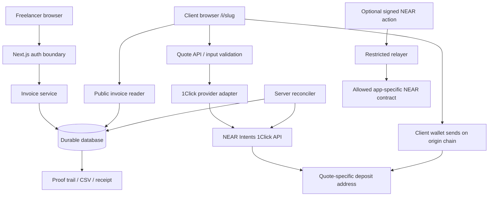

# Openteller — Technical Architecture

Status: proposed implementation blueprint, 4 November 2026. Requirements grounded in `SPEC.md`; provider verification in `INTEGRATIONS.md`; visuals in `DESIGN.md`. **Proposals here are not decisions already made by the builder.**

## 1. Stack and boundaries

- Next.js App Router, TypeScript strict, Tailwind CSS; install `motion`, run `npx motion-ai`, install `react-aria-components` per `DESIGN.md`. No generic icon library. Self-host approved fonts.
- React Server Components for data-heavy/read-mostly pages; minimal client components for accessible forms, token selection, motion and quote/payment state.
- Route Handlers or Server Actions for authorized mutations; never put JWTs or relayer private keys in the browser.
- **DECIDED 4 November 2026:** Neon Postgres is the durable relational store, accessed server-side with Drizzle ORM and versioned generated SQL migrations. Neon Managed Better Auth supplies Google/GitHub identity and HTTP-only sessions through `/sign-in`. Vercel hosts the noncommercial hackathon deployment. Local-only SQLite, browser storage and in-memory repositories are never presented as hosted persistence.
- `paymentProvider` interface allows fixtures in development and live 1Click calls after integration checks; payment records persist regardless of browser refresh.

## 2. High-level data flow



The relayer is **separate** from source-chain deposits and must never be implied to pay the client's origin-chain gas.

## 3. Data model (approved baseline; evolve through reviewed migrations)

### User/Account
`id`, `auth_subject`, `near_account_id`, `created_at`. Unique index on `auth_subject`. If wallet auth chosen, verify possession securely using a nonce/signature and a server session.

### Invoice
`id` (UUID/ULID), `owner_id`, `public_slug` (unguessable random; unique), `invoice_number` (owner-scoped unique), `client_name`, `issued_at`, `due_at`, `notes`, `currency='USDC'`, `total_minor` (integer or numeric string), `recipient_near_account`, `status`, `created_at`, `updated_at`, `voided_at?`. Amount fields never floats. **OPEN:** precision/bounds.

### InvoiceItem
`id`, `invoice_id`, `position`, `description`, `quantity_scaled`, `unit_price_minor`, `line_total_minor`. Choose explicit decimal quantity scale once verified. Enforce ordered, contiguous line items and server-side recalculation.

### PaymentAttempt
`id`, `invoice_id`, `provider='1click'`, `mode='fixture'|'live'`, `provider_status`, `ui_status`, `deposit_address`, `origin_asset_id`, `destination_asset_id`, `origin_chain`, `quoted_origin_base_units?`, `requested_destination_base_units`, `refund_destination`, `quoted_at`, `expires_at`, `confirmed_at?`, `received_destination_base_units?`, `raw_provider_response_ref?`. One invoice can have multiple attempts, but do **not** aggregate them into Paid without confirmed reconciliation rules.

### PaymentEvidence
`id`, `payment_attempt_id`, `kind` (`origin`/`destination`/`refund`), `chain`, `tx_hash`, `amount_base_units?`, `asset_id?`, `observed_at?`, `verified_at?`, `evidence_source`. All nullable provider-derived values are truly nullable. Unique deduplication key where safely available. `tx_hash` must not be invented.

### InvoiceEvent
`id`, `invoice_id`, `payment_attempt_id?`, `event_type`, `occurred_at`, `source`, `source_event_key?`, `metadata_json` (sanitized), `created_at`. Append-only. Unique source event key for idempotent reconciliation.

### QuoteRequestLog (optional; minimize data retention)
`id`, `invoice_id`, `quote_request_id`, `created_at`, `outcome`, `error_code` (no sensitive raw keys).

## 4. Domain invariants

1. Invoice totals are calculated on server and persist as integers; stored item sums equal invoice total.
2. Invoice owners alone can read private invoices and exports; a public slug never exposes owner-internal fields.
3. Invoice voiding rejects already Paid invoices and handles pending payment attempts conservatively. **OPEN:** what voiding means if a deposit is in flight; safest choice is disallow while payment is pending.
4. Invoice status derives from durable evidence; client-side state alone never marks an invoice Paid.
5. Quote expiry is server-authoritative and tracked per attempt; expired instructions are not actively presented.
6. Provider statuses can arrive out of order. Reconciliation is idempotent; Paid cannot regress due to an older `PENDING_DEPOSIT` poll.
7. Never send a quote request with a refund address owned by the freelancer unless the payer explicitly controls that address.
8. Secrets cannot be included in database exports, client payloads or logs.

## 5. Payment state machine (provisional)

```text
Invoice: Open -> Pending -> Paid
               |       |
               |       +--- terminal after verified settlement
               +-> Underpaid (requires payer resolution; VERIFY)
               +-> Refunded (returned funds; VERIFY)
               +-> Error/action required (FAILED; handling OPEN)
Open -> Void (only when no in-flight attempts)
```

Raw provider statuses remain preserved separately:

| 1Click raw status | Suggested UI interpretation |
| --- | --- |
| `PENDING_DEPOSIT` | Open / quote pending; not proof funds arrived |
| `KNOWN_DEPOSIT_TX` | Pending |
| `PROCESSING` | Pending |
| `SUCCESS` | Candidate Paid; confirm destination and invoiced amount |
| `INCOMPLETE_DEPOSIT` | Underpaid; outstanding value **VERIFY** |
| `REFUNDED` | Refunded; verified refund fields **VERIFY** |
| `FAILED` | Error/action required; not a defined final UI pill yet |

Do not merge multiple attempts or partial payments without an explicit reconciliation policy.

## 6. API surface (proposed contracts; names may change with implementation)

| Method/route | Auth | Responsibility |
| --- | --- | --- |
| `GET /api/invoices` | Freelancer | Owner-scoped list/filter |
| `POST /api/invoices` | Freelancer | Validate, calculate, persist invoice |
| `GET /api/invoices/:id` | Freelancer | Owner-scoped details/trail |
| `POST /api/invoices/:id/void` | Freelancer | Validate state, append event |
| `GET /api/public/invoices/:slug` | Public | Minimum client-safe invoice data |
| `POST /api/public/invoices/:slug/quotes` | Public + protection | Validate network/token/refund, create live/dry quote |
| `GET /api/public/invoices/:slug/status` | Public + protection | Sanitized stored status; server does reconciliation |
| `GET /api/exports/payments.csv` | Freelancer | Authenticated export |
| `/api/relayer` | Server/verified client, only if needed | Allowlisted signed delegated actions |

Use bounded server rate limits on public quote endpoints; do not proxy arbitrary 1Click inputs; validate slug and asset IDs from allowlisted fetched metadata. Provider base URL fixed by configuration, not user inputs. Treat public routes as subject to enumeration, quote abuse, and scraping; use random slugs and throttling.

## 7. Suggested source tree

```text
app/
  (public)/page.tsx
  i/[slug]/page.tsx
  (freelancer)/invoices/page.tsx
  (freelancer)/invoices/new/page.tsx
  (freelancer)/invoices/[id]/page.tsx
  (freelancer)/invoices/[id]/receipt/page.tsx
  (freelancer)/exports/page.tsx
  api/.../route.ts
  globals.css
components/
  ui/                 # styled React Aria wrappers
  icons/              # custom SVG icon components
  invoice/            # slab, tape, summary, status
  motion/             # client-only reveal/change components
lib/
  auth/               # unresolved auth adapter
  db/                 # schema, migrations, repository
  money/              # integer arithmetic / formatters
  invoices/           # domain rules
  payments/           # 1Click adapter, status mapper, reconciler
  exports/            # safe CSV
  config/             # server-only validated environment
fixtures/             # clearly marked synthetic responses
tests/
```

## 8. UI runtime and performance

- Only animate `transform` and `opacity`; prefer one-time intersection-driven scroll reveal for below-the-fold landing content, disabled under reduced motion. Keep payment controls present on first paint.
- Follow exact Motion rules/tokens in `DESIGN.md`; avoid `layout` animations on long tables and continuous scroll listeners.
- Use React Aria Components for accessible primitive behavior while rendering fully custom visual components. No visually generic UI kits.
- Lazy-load bulky quote/picker logic; no client-side chain SDK imported into every route; no hydration of entire static landing page.

## 9. Deployment architecture and limitations

The hackathon deployment uses Vercel with Neon Postgres. Vercel Hobby is restricted to personal/noncommercial use, so commercial production hosting requires a later builder decision. Payment reconciliation starts request-driven: a client or freelancer status request may trigger a bounded server-side provider refresh and durable update. A scheduled job may be added only after provider limits and the deployed trigger are verified; never assume an always-running Node timer or promise automatic updates without evidence.

## 10. Testing strategy

- Unit: amounts, token base units, item total integrity, date format, state machine, CSV injection/quoting.
- Component: React Aria keyboard navigation; token picker; reduced-motion; validation errors.
- Integration: create/reload/void; owner A denied owner B; public slug shows minimum; quote retries/idempotency; expired deposit instructions; provider status mapping.
- E2E: freelancer creates, client opens, dry quote selection, visible Pending, fixture-driven Paid only with explicit DEMO badge, export; separate tagged live paid-flow E2E only when test funds available.
- Security: secret leak scan, relayer deny tests, rate limits, malformed network/asset/refund address input, signed-session validation.
